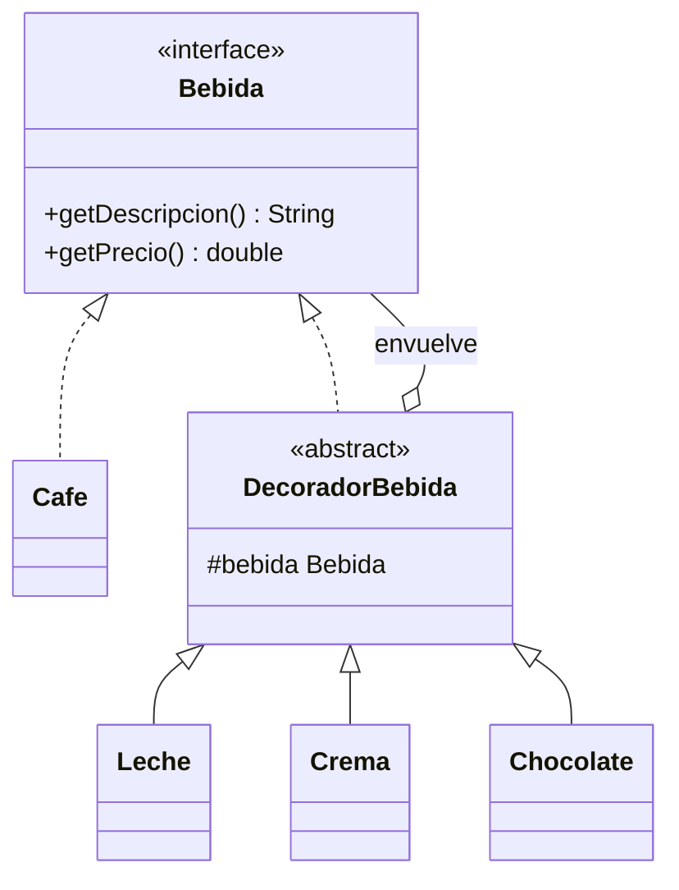

# Patrón Decorator: Cafetería

Ejemplo del patrón estructural **Decorator** en Java 

## ¿Qué es el patrón Decorator?
Permite **agregar comportamiento a un objeto en tiempo de ejecución** envolviéndolo en otros objetos ("decoradores") que implementan la misma interfaz. Es una alternativa flexible a la herencia.

## Problema que resuelve este ejemplo
Una cafetería vende café con extras opcionales: leche, crema y chocolate. Con herencia tendríamos que crear una clase por cada combinación (`CafeConLeche`, `CafeConLecheYCrema`, `CafeConLecheCremaYChocolate`...), y cada extra nuevo duplicaría las clases.

Con Decorator hay **una clase por extra**, y los extras se combinan como se quiera.

## Diagrama de clases



## Clases

| Archivo | Rol en el patrón | Qué hace |
|---|---|---|
| `Bebida.java` | Componente (interfaz) | Define `getDescripcion()` y `getPrecio()` |
| `Cafe.java` | Componente concreto | Bebida base: "Café", $3000 |
| `DecoradorBebida.java` | Decorador base | Implementa `Bebida` y guarda la bebida que envuelve |
| `Leche.java` | Decorador concreto | Agrega " + leche" y suma $1000 |
| `Crema.java` | Decorador concreto | Agrega " + crema" y suma $1500 |
| `Chocolate.java` | Decorador concreto | Agrega " + chocolate" y suma $2000 |
| `Main.java` | Cliente | Arma los pedidos envolviendo objetos |

## Cómo funciona paso a paso
```java
Bebida pedido = new Chocolate(new Crema(new Leche(new Cafe())));
pedido.getPrecio();
```
Cada capa le pregunta a la de adentro y suma lo suyo:

```
Chocolate.getPrecio() = Crema.getPrecio()  + 2000
Crema.getPrecio()     = Leche.getPrecio()  + 1500
Leche.getPrecio()     = Cafe.getPrecio()   + 1000
Cafe.getPrecio()      = 3000
```
Resultado: 3000 + 1000 + 1500 + 2000 = **7500**.

## Cómo ejecutarlo
Requiere Java 17 o superior. Desde esta carpeta:

```bash
javac -encoding UTF-8 *.java
java Main
```

## Salida esperada
```
Café = $3000 COP
Café + leche + crema + chocolate = $7500 COP
Café + leche + leche = $5000 COP
```

## Cómo agregar un extra nuevo
Crear una sola clase, sin tocar las existentes (principio abierto/cerrado):

```java
public class Canela extends DecoradorBebida {
    public Canela(Bebida bebida) { super(bebida); }
    public String getDescripcion() { return bebida.getDescripcion() + " + canela"; }
    public double getPrecio() { return bebida.getPrecio() + 500; }
}
```

## Ventajas y desventajas
**Ventajas**
- Agrega funciones sin modificar las clases existentes.
- Evita la explosión de subclases.
- Los extras se combinan y se repiten libremente en tiempo de ejecución.

**Desventajas**
- Muchas clases pequeñas.
- El orden de las capas puede importar en otros casos (por ejemplo, cifrar y luego comprimir).
